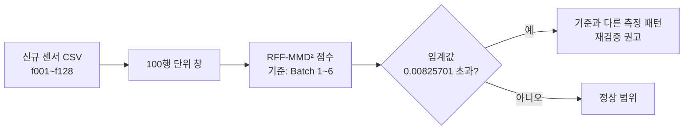
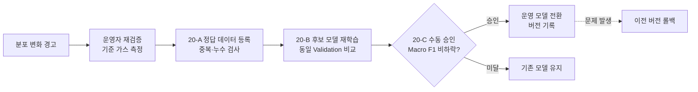

# 🧪 Gas Sensor Drift Classification — 시간이 지나도 믿을 수 있는 가스 분류

> 128개 센서 특징으로 **6종 가스를 분류**하고, 측정 시기가 바뀌며 생기는 **성능 저하를 분석**한 뒤, 정답 없는 새 데이터의 **분포 변화를 감지**하고 **승인 기반으로 모델을 재학습·교체**하는 머신러닝 운영 시스템

| 항목 | 내용 |
|---|---|
| 기간 | 2026.10 |
| 소속 | 휴먼AI교육센터 · 인공지능(AI)서비스 기반 웹 개발자 심화 과정 머신러닝 프로젝트 |
| 인원 | 1명 (개인 프로젝트) |
| 역할 | 데이터 분석 · 모델링 · 분포 변화 감지 · Streamlit 웹앱 · 모델 관리 기능 전체 |
| 데이터 | [UCI Gas Sensor Array Drift Dataset (ID 224)](https://doi.org/10.24432/C5RP6W) |
| 실행·설치 상세 | [docs/DEVELOPMENT.md](docs/DEVELOPMENT.md) |

## 목차

| # | 구분 | 내용 |
|---|---|---|
| 01 | 프로젝트 개요 | 추진 배경 · 문제 정의 · 목표 · 범위 |
| 02 | 데이터 분석 | 데이터 구성 · EDA · 전처리 |
| 03 | 모델링 | 평가 설계 · 기준 모델 선정 · 성능 저하 분석 · 개선 실험 |
| 04 | 분포 변화 감지 | RFF-MMD² 감지기 · 결과 · 한계 |
| 05 | 웹앱과 모델 관리 | Streamlit 화면 · 정답 등록 → 재학습 → 승인 · 롤백 |
| 06 | 테스트 | 검증 범위 |
| 07 | 결론 및 회고 | 결과 · 트러블슈팅 · 한계 · 배운 점 |

---

# 01. 프로젝트 개요

## 1.1 추진 배경

가스 센서는 사용 시간, 주변 환경, 센서 특성 변화에 따라 **같은 가스를 측정해도 출력 패턴이 달라질 수 있습니다(센서 드리프트).** 그래서 과거 데이터로 학습한 분류 모델은 새로운 시기에 성능이 떨어질 수 있습니다.

| 문제 | 설명 | 이 프로젝트의 접근 |
|---|---|---|
| Q1 평가 착시 | 랜덤 분할은 같은 시기 데이터가 학습·평가에 섞여 실제 미래 성능을 보여 주지 못함 | **과거 → 미래 시간순 평가**를 주 평가로 채택 |
| Q2 평균 뒤에 숨은 실패 | 전체 정확도가 높아도 특정 가스는 심각하게 오분류될 수 있음 | **Batch별 · 가스별** 성능과 오분류 분석 |
| Q3 정답이 없는 현장 | 실제 측정 환경에서는 정답이 없어 성능을 즉시 확인할 수 없음 | 정답 없이 계산하는 **분포 변화 감지기** |
| Q4 무분별한 모델 교체 | 경고만으로 모델을 바꾸면 오히려 성능이 나빠질 수 있음 | **정답 확인 → 후보 학습 → 비교 → 수동 승인 → 롤백** 절차 |

## 1.2 프로젝트 목표

| # | 목표 |
|---|---|
| 1 | 128개 센서 특징으로 6종 가스 분류 모델을 만들고, 랜덤·시간순 평가로 기준 모델 선정 |
| 2 | Batch별 · 가스별 성능 저하와 오분류 원인을 분석하고 개선 실험으로 검증 |
| 3 | 정답 없는 데이터에서 RFF-MMD² 기반 분포 변화 감지 |
| 4 | 분류 · 감지 결과를 보는 Streamlit 웹앱 구축 |
| 5 | 신규 정답 등록 → 후보 재학습 → 성능 비교 → 수동 승인 · 전환 · 롤백 기능 구현 |

## 1.3 범위

| 구분 | 내용 |
|---|---|
| 포함 | EDA, 전처리 Pipeline, LR · RF · SVM 비교, 시간순 평가, 개선 실험, 분포 변화 감지, Streamlit 웹앱, 재학습 · 승인 · 롤백 |
| 제외 | 가스 농도 · 누출 · 유해성 판정, 실제 센서 장비 연동, 사용자 인증 |

---

# 02. 데이터 분석

## 2.1 데이터 구성

| 항목 | 내용 |
|---|---|
| 규모 | 13,910건 · 10개 Batch(측정 시기) |
| 정답 | 6종 가스 — Ethanol, Ethylene, Ammonia, Acetaldehyde, Acetone, Toluene |
| 입력 | 센서 16개 × 특징 8개 = 128개 (f001 ~ f128) |
| 클래스 불균형 | 최다 Acetone 3,009건(21.6%) · 최소 Ammonia 1,641건(11.8%), 약 1.83배 |
| Batch 크기 | 161건(Batch 4) ~ 3,613건(Batch 7) |

## 2.2 EDA 주요 발견

| 분석 | 발견 | 시사점 |
|---|---|---|
| Batch별 가스 구성 | Batch 3~5에는 Toluene이 없고, Batch 2·8에는 각각 5건·18건뿐 | 시기마다 학습할 수 있는 가스가 다름 |
| 같은 가스의 시기별 이동 | Batch 10 Acetone은 Batch 1 대비 평균 특징 이동 **1.718**로 가장 큼 | 시간순 평가가 반드시 필요 |
| 특징 간 상관 구조 | Toluene 센서 S5의 f033–f034 상관계수가 Train 1~7 **0.815** → Batch 9 **−0.786**으로 반전 | 같은 가스도 시기에 따라 특징 관계가 바뀜 |
| 이상치 후보 | f001의 1.5×IQR 이상치 후보 1,418건(10.19%) | 실제 센서 반응일 수 있어 삭제하지 않고 표준화로 보완 |

## 2.3 전처리

| 항목 | 결과 · 처리 |
|---|---|
| 결측치 · 무한대 · 중복 · 정답 충돌 | 모두 0건 → 13,910건 전부 유지 |
| 입력 분리 | f001~f128만 입력, gas · Batch · 식별 정보는 분리 |
| 누수 방지 | `SimpleImputer → StandardScaler → 모델`을 하나의 Pipeline으로 묶어 **Train에서만 기준 계산** |
| 결측 대비 | 원본 결측은 없지만 신규 입력 대비로 Train 중앙값 대치 단계 유지 |

---

# 03. 모델링

## 3.1 랜덤 분할 vs 시간순 평가

| 모델 | 랜덤 분할 Macro F1 | 시간순 (Train 1 → 이후) | 시간순 (Train 1~3 → 이후) |
|---|---|---|---|
| Logistic Regression | 0.9919 | 0.3138 | 0.5493 |
| Random Forest | 0.9947 | 0.3274 | 0.4595 |
| SVM (RBF) | 0.9845 | 0.2929 | 0.5788 |

랜덤 분할에서는 세 모델 모두 **0.98 이상**이지만, 과거로 학습해 미래를 평가하면 **0.29 ~ 0.58로 급락**했습니다. 최고 모델도 랜덤(RF)과 시간순(SVM)에서 달라, **시간순 평가를 주 평가로 채택**했습니다.

## 3.2 공식 기준 모델 선정

| 구분 | 설정 |
|---|---|
| Train | Batch 1~6 (5,933건) |
| Validation | Batch 7~8 (3,907건) — Batch별 Macro F1 동일 가중 평균으로 선정 |
| 사후 평가 | Batch 9~10 (4,070건) — 모델 고정 후 확인 |
| 선정 모델 | **balanced RBF SVM (Model A)**, Validation Macro F1 **0.8970** |
| balanced 효과 | 기본 가중치 0.8629 → balanced 0.8970 |

## 3.3 성능 저하와 오분류 분석

| Batch | Model A Macro F1 |
|---|---|
| 7 · 8 (Validation) | 약 0.897 |
| 9 | 0.6708 |
| 10 | 0.5346 |
| 9~10 동일 가중 평균 | **0.6027** |

| 집중 실패 | 내용 |
|---|---|
| Batch 9 Toluene | 101건 **전부** Ethanol로 오분류 (Recall 0%) |
| Batch 10 Acetaldehyde | Recall **14.0%** |
| 원인 후보 | 학습 Toluene 546건 중 467건(85.53%)이 Batch 6에 집중 → 학습 시기 대표성 부족 |
| ROC-AUC | 6종 OvR 평균 **0.8505**, Acetaldehyde 0.6376으로 최저 |

## 3.4 개선 실험

성능 저하 원인을 네 방향에서 검증했습니다.

| 방향 | 실험 | 결론 |
|---|---|---|
| 학습 시기 구성 | 학습 범위 확장 (Train 1~7 → Batch 9~10) | 평균 Macro F1 **0.6027 → 0.7005**, 단 Toluene 실패는 남음 |
| 특징 · 가중치 | 시기 가중치, 특징 선택, signed_log · Yeo-Johnson 변환 | 일관된 개선 없음 |
| 알고리즘 · 결합 | 시기별 SVM 앙상블, HistGradientBoosting | 일부 가스 개선 · 일부 악화 |
| 새 시기 정답 적응 | 대상 시기 정답 일부를 학습에 추가 | 정답 5% 활용 시 **80.24% → 92.26%**, 최대 **94.61%** |

**결론:** 모델이나 특징을 바꾸는 것보다 **학습 데이터의 시기 대표성과 새 시기의 확인된 정답**이 성능에 가장 큰 영향을 줬습니다. 다만 독립 검증이 없어 공식 모델은 Model A를 유지하고, 이 결과를 **"정답 확보 후 재학습" 운영 절차**로 연결했습니다.

---

# 04. 분포 변화 감지

정답이 없으면 정확도를 계산할 수 없으므로, **기준 데이터와 다른 측정 패턴**을 감지해 재검증 시점을 알려 줍니다.



| 항목 | 내용 |
|---|---|
| 방식 | Random Fourier Features 기반 MMD² — 기준 분포와 새 데이터 분포의 차이 |
| 기준 | Batch 1~6, 기준 내부 Calibration 점수의 95% 수준을 임계값으로 고정 |
| 정답 사용 | 감지기 학습 · 임계값 결정에 **정답을 쓰지 않음** |

| 구간 | 창 수 | 경고 |
|---|---|---|
| 기준 내부 평가 | 14 | 1 (7.1%) |
| Batch 7 | 36 | **36 (100%)** |
| Batch 8 | 2 | **2 (100%)** |

| 한계 확인 | 내용 |
|---|---|
| 점수 ≠ 오류율 | 경고된 3,800건 중 오분류 391건(10.29%), 점수–오류율 Spearman 약 −0.292 |
| 구성 민감도 | 창 재배열 시 Batch 7 점수 약 60%, 가스 구성 통제 시 약 72% 감소 (경고율은 100% 유지) |
| 해석 원칙 | 경고는 **재검증 권고**이며, 센서 고장이나 분류 오류를 확정하지 않음 |

---

# 05. 웹앱과 모델 관리

## 5.1 Streamlit 웹앱

| 기능 | 내용 |
|---|---|
| CSV 업로드 | f001~f128 필수, gas 정답은 선택 |
| 가스 분류 | 측정별 예측 가스 · 실제 가스 · 일치 여부 |
| 성능 평가 | 정답이 있으면 Accuracy · Macro F1 · 가스별 지표 · Confusion Matrix |
| 분포 변화 감지 | 100행 구간별 점수 · 기준 초과 여부, 100행 미만은 "평가 불가"로 구분 |
| 다운로드 | 분석 결과 CSV 3종 |

## 5.2 정답 기반 재학습 · 승인 · 롤백



| 단계 | 핵심 기능 | 안전 장치 |
|---|---|---|
| 20-A 정답 등록 | 출처 · 수집 세션 · 측정 시각 확인 후 Train · Validation 분리 등록 | 기존 데이터와 중복 · 누수 검사, 조건 미충족 시 저장 차단 |
| 20-B 후보 재학습 | 기존 5,933건 + 신규 Train으로 같은 SVM 학습, 동일 Validation 비교 | 후보는 별도 저장, **자동 적용하지 않음** |
| 20-C 승인 · 롤백 | 근거 확인 + Macro F1 비하락 시에만 운영 모델 전환 | 파일 덮어쓰기 없이 운영 포인터 · 이력 갱신, 이전 버전 복구 가능 |

> 실제 신규 센서 정답 데이터가 없어 재학습 · 승인 · 롤백은 **합성 데이터와 임시 환경에서 기능만 검증**했습니다. 운영 모델은 Model A를 유지합니다.

---

# 06. 테스트

| 구분 | 내용 |
|---|---|
| 도구 | pytest — 테스트 파일 15개 · 테스트 함수 142개 |
| 데이터 · 누수 | 원본 파싱 · 분할 · Train-only 전처리 검사 |
| 모델 · 수치 | 공식 모델 재로딩, 기존 예측 · 지표 재현, 결과 지문 검사 |
| 감지기 | RFF-MMD² 점수 · 임계값 · 민감도 실험 |
| 웹앱 | Streamlit 통합 · 가독성 · 클라우드 배포 설정 |
| 모델 관리 | 후보 학습 · 승인 · 롤백을 임시 디렉터리 합성 데이터로 검증 (운영 상태 변경 없음) |

---

# 07. 결론 및 회고

## 7.1 결과 요약

| 항목 | 결과 |
|---|---|
| 기준 모델 | balanced RBF SVM, Validation Macro F1 0.8970 |
| 시간에 따른 저하 | Batch 9~10 평균 0.6027, Toluene · Acetaldehyde 집중 실패 확인 |
| 가장 효과적인 개선 | 학습 범위 확장(0.7005), 새 시기 정답 5% 적응(92.26%) |
| 분포 변화 감지 | 정답 없이 Batch 7 · 8의 모든 창(38/38)에서 기준과 다른 패턴 감지 |
| 운영 시스템 | Streamlit 분류 · 감지 웹앱 + 정답 등록 → 재학습 → 수동 승인 · 롤백 |

## 7.2 트러블슈팅

### ① 랜덤 분할 성능에 속을 뻔한 문제

| 구분 | 내용 |
|---|---|
| 문제 | 랜덤 분할로는 모든 모델이 0.98 이상이라 바로 써도 될 것처럼 보임 |
| 원인 | 같은 Batch의 다른 표본을 이미 학습해, 새 시기의 성능을 반영하지 못함 |
| 해결 | 과거 → 미래 시간순 평가를 주 평가로 바꾸고, Validation · 사후 평가 구간을 고정 |
| 결과 | 실제 미래 성능(0.29~0.58)을 드러내고, 모델 선정 기준 자체를 바꿈 |

### ② 평균 뒤에 숨은 특정 가스의 실패

| 구분 | 내용 |
|---|---|
| 문제 | 전체 평균은 괜찮아 보였지만 Batch 9 Toluene은 101건 전부 오분류 |
| 원인 | 학습 Toluene의 85.53%가 한 Batch에 몰려 시기 대표성이 부족 |
| 해결 | 가스별 · Batch별 지표와 Confusion Matrix를 기본 평가에 포함, 학습 시기 구성 실험 |
| 결과 | "모델 교체"보다 "새 시기 정답 확보 후 재학습"이 효과적이라는 근거를 얻고 운영 절차로 연결 |

## 7.3 한계와 향후 과제

| 한계 | 향후 과제 |
|---|---|
| Batch 9~10은 반복 확인한 자료라 독립 Test가 아님 | 개발에 쓰지 않은 신규 측정 자료로 한 번만 평가 |
| 재학습 · 승인 · 롤백은 합성 데이터로만 검증 | 실제 신규 정답 데이터로 절차 적용 |
| 시각 · 농도 · 환경 정보가 없어 분포 경고를 물리적 드리프트와 연결할 수 없음 | 조건을 통제한 기준 가스 반복 측정으로 오경보 · 미탐지 검증 |
| 인증 없는 로컬 프로토타입 | 현장 적용 시 인증 · 접근 통제, 센서 특징 호환성 확인 |

## 7.4 배운 점

| 키워드 | 내용 |
|---|---|
| 평가 설계가 먼저 | 어떤 모델이 좋은지는 "어떻게 평가하느냐"에 따라 완전히 달라진다 |
| 평균을 믿지 않기 | 평균 지표 뒤에 숨은 특정 클래스의 실패를 반드시 따로 본다 |
| 결과를 과장하지 않기 | 반복 확인한 자료, 합성 검증, 통계적 분포 차이를 실제 성능 · 물리적 원인과 구분해 기록 |
| 모델은 운영까지 | 좋은 모델 하나보다, 경고 → 재검증 → 재학습 → 승인 → 롤백이 반복되는 구조가 현장에서 더 중요하다 |

---

## 실행 방법

```powershell
python -m venv .venv
.\.venv\Scripts\python.exe -m pip install -r requirements-streamlit.txt
.\.venv\Scripts\python.exe -B -m src.model_management.initialize
.\.venv\Scripts\python.exe -B -m streamlit run app_streamlit.py --server.address 127.0.0.1
```

설치 · 모델 준비 · Notebook · 테스트 · 배포의 상세 내용은 [docs/DEVELOPMENT.md](docs/DEVELOPMENT.md)를 참고하세요.

## 기술 스택

| 구분 | 기술 |
|---|---|
| 언어 · 분석 | Python 3.12 · pandas · NumPy · SciPy · Jupyter Notebook · Matplotlib |
| 모델링 | scikit-learn (Logistic Regression · Random Forest · SVM · HistGradientBoosting) · joblib |
| 분포 변화 감지 | RFF-MMD² (Random Fourier Features) |
| 웹앱 | Streamlit · Altair |
| 테스트 | pytest |

## 데이터 출처

Vergara, A. (2012). Gas Sensor Array Drift Dataset. UCI Machine Learning Repository. https://doi.org/10.24432/C5RP6W
