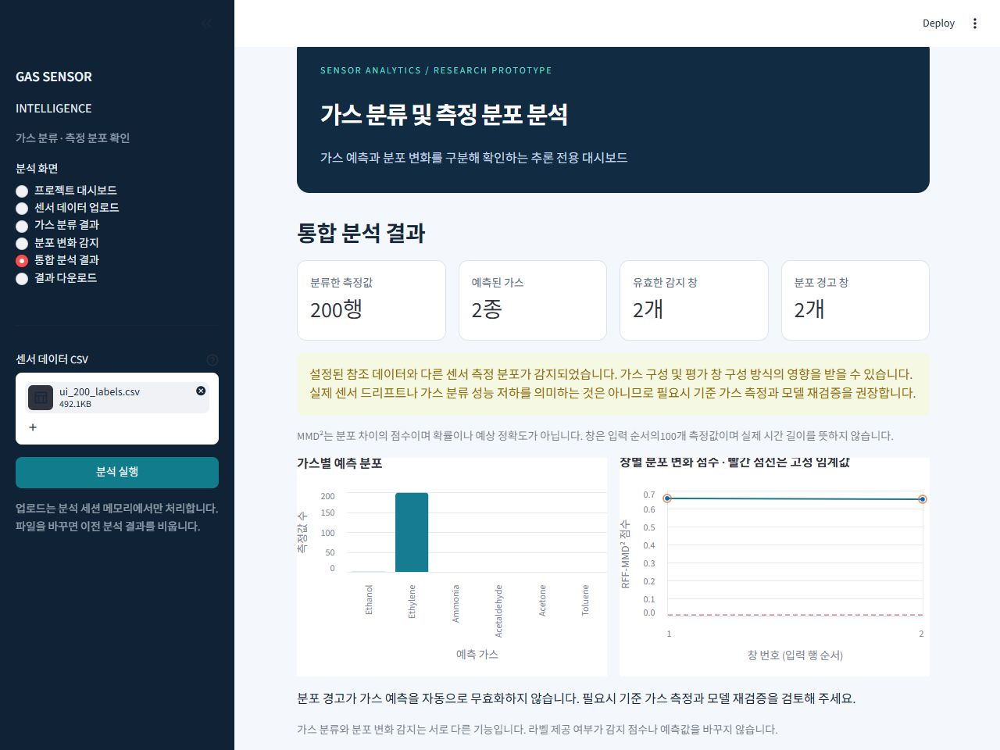

# 19단계 Streamlit 가스 분류·분포 변화 통합 보고서

## 최종 판정: B

핵심 기능과 실제 실행을 검증했으나 인앱 브라우저의 최종 파일 저장 완료 확인은 미완료다. 이를 미확인 상태로 남기며 모든 완료 조건의 A 판정을 주장하지 않는다.

## 구현 기능과 처리 흐름

CSV 업로드 → 중복 제목·필수/추가 열·수치·정답 검증 → 선택적 gas 분리 → f001~f128 이름 기준 정렬 → 저장 Model A의 predict → 독립적인 기존 감지기의 evaluate → 행별 예측·창 점수·선택적 정답 평가·시각화 → 메모리에서 CSV 다운로드 생성.

화면은 대시보드·입력·가스 분류·분포 변화·통합 결과·다운로드의6개다. 모델 객체만 st.cache_resource로 공유하며 업로드별 결과는 세션 메모리에 둔다. 파일 내용 변경이나 제거 시 이전 결과와 오류를 비운다. 업로드 파일을 앱에서 디스크에 저장하지 않는다.

필수 특징128개, 선택적 gas=정수1~6.20MB·20,000행 한도. 이름만 순서가 다르면 명시적으로 재정렬한다. 알 수 없는 열·중복 열·비수치·무한대·전체 결측·빈 레코드는 거부하고 일부 결측만 각 저장 파이프라인의 기존 중앙값으로 처리한다. gas가 없으면 실제 Accuracy·Macro F1을 표시하지 않는다. 가스별 support와 정답에 실제 존재하는 클래스 수를 함께 표시한다.

가스 분류는100행 미만에서도 가능하다. 감지는100행 비중복 창, 마지막 미완성 창은 제외한다. 평가 불가 창과 이유를 공개하고 경고율의 분모는 유효 창이다. 분포 경고는 예측값을 변경하지 않는다.

## 사용 모델·환경

- 공식 Model A: `models\temporal_expansion\B_SVM_balanced.joblib` / SHA-256 `1d6b20c94d1580d799e05ab5a9ce746bdb272d74f70ec2ff964011fffecfde32`

- 감지기: `models\drift_detection\rff_mmd_v1.joblib` / SHA-256 `de47661f66c69cdc7553f73acf1df9b721f65771d0301fe69a7a326f814fa4c5`

- 감지 조건: rff_mmd_v1,128특징,RFF512차원,100행 창,임계값 `0.00825701197565701`

- 환경: numpy=2.5.4, pandas=2.3.3, scipy=1.18.1, scikit-learn=1.9.1, joblib=1.6.0, matplotlib=3.11.2, streamlit=1.66.1, altair=6.3.0

기존 연구 의존성 버전은 유지했다. 웹앱 의존성은 requirements-streamlit.txt, 기존 핵심 버전 제약은 constraints-streamlit.txt, 설치 환경 전체 고정 목록은 requirements-streamlit-lock.txt로 분리했다. 기존 requirements.txt·lock은 수정하지 않았다.

## 실제 실행 및 검증

localhost127.0.0.1:8501의 실제 Streamlit 서버를 실행하고 health 응답ok, 모델 로딩, 브라우저의 CSV 업로드, 라벨 유무, 분류·감지·통합 그래프, 정답 평가 영역과 혼동 행렬을 확인했다. 실제 브라우저에서 업로드 제거 후 결과가 비워지는 것도 확인했다. 좁은 화면의 숫자 잘림·업로드 파일명 대비를 보완하고, 좁은 기본 화면과1280×960 데스크톱 배치를 확인한 뒤 viewport를 원복했다.

신규34개 테스트는 서비스 및 Streamlit AppTest의 실제 파일 업로드 위젯을 사용한다. 99·100·101·200행, 라벨 유무, 오류12종, 특징 순서·정답 독립성, 창 내부 결측, 다운로드 행 정렬·내용, 파일 변경,6화면, 경고·확률 금지, 학습·업로드 파일 쓰기 호출 부재를 검사했다.

Batch7 첫200행은 메모리에서만 앱 서비스에 전달해 기존14단계 B/baseline 저장 예측과 행별 일치를 확인했다. 새로운 모델 성능 비교나 Batch9~10 성능 평가는 하지 않았다.

다운로드3종은 실제 실행 중인 서버에서 HTTP200·Content-Disposition attachment를 확인했고 각각200행·2행·1행이며 기대 CSV와 바이트 단위로 일치했다. 인앱 브라우저의 다운로드 완료 이벤트가 시간 초과되어 최종 사용자 파일 저장 완료는 확인하지 못함. 다운로드 버튼·AppTest 클릭·실제 서버의 attachment 응답과 CSV 내용은 검증됐으나 이를 로컬 브라우저 파일 저장 완료와 동일하게 처리하지 않음.

합성 UI 입력의 평가 숫자는 기능 검사 결과일 뿐 가스 분류 연구 성능으로 보고하지 않는다. fixtures와 browser_downloads에 보관한 내용도 합성 기능 검사용이며 사용자 업로드의 영구 저장 기능이 아니다.

## 전체 테스트

- 통과176개 / 실패2개 / 건너뜀90개

- 신규34개 모두 통과 / 신규 실패0개

실패2개는 과거 누락 임시 파일과 고정 모델 목록 검사다. 이전 역사적 실패5개 중3개는 원본9~10 접근 제한 때문에 건너뛰었으며 해결됐다고 주장하지 않는다.90개 건너뜀에는 과거 산출물 쓰기 제한도 포함된다. 기존 테스트·해시·고정 목록을 수정하지 않았다.

## 보존 검사

기존 모델325개와 보존 대상 파일1403개의 SHA-256이 일치했다. 원본10개도 보존용 해시만 확인했다. Batch9~10은 수치 분석·새 예측·튜닝에 사용하지 않았다. 기존18·18.5 코드·보고서·결과 및 기존 Streamlit 어댑터를 유지했다.

## 실행 방법 및 산출물

현재 실행 URL: http://127.0.0.1:8501 . 실행 명령·입력 규칙·해석 한계는 README_streamlit.md 참조.

```powershell
.\.venv\Scripts\python.exe -B -m streamlit run app_streamlit.py --server.address 127.0.0.1 --server.port 8501 --server.headless true --browser.gatherUsageStats false --server.fileWatcherType none --server.maxUploadSize 20
```

신규 파일:
- `app_streamlit.py`
- `README_streamlit.md`
- `requirements-streamlit.txt`
- `requirements-streamlit-lock.txt`
- `constraints-streamlit.txt`
- `tests\test_streamlit_integration.py`
- `src\webapp\audit.py`
- `src\webapp\closeout.py`
- `src\webapp\service.py`
- `src\webapp\testing_guard.py`
- `src\webapp\ui.py`
- `src\webapp\verify_runtime.py`
- `src\webapp\__init__.py`

실행·테스트·브라우저·다운로드·보존 기록: outputs/streamlit_integration/. 기존 파일 수정 없음. 기존 가상환경에는 Streamlit과 관련 패키지를 추가 설치했다. Git Commit·Push 없음.

## 한계 및 다음 단계

현재는 로컬 연구 프로토타입이다. 실제 브라우저의 파일 저장 완료는 미확인이고, 인증·다중 사용자 부하·외부 배포·실제 장비 입력은 검증하지 않았다. 업로드 정답의 진실성, 파일 내 실제 시간 순서와 Batch 경계는 알 수 없다. 전체 파일을 사용자가 일관된 구간으로 준비해야 한다.

18.5단계의 창 구성 민감도와 반복 개발 자료의 편향을 화면에 반영했다. MMD²는 고장 확률·드리프트 확률·예상 정확도가 아니다. 자동 교정·재학습·관리자 승인·모델 교체 기능을 구현하지 않았으며 작동하는 기능처럼 표시하지 않는다.

다음 단계는 일반 브라우저의 실제 저장 완료 확인과 운영 입력 규칙 검증이다. 이후 반자동 재학습을 진행하려면 별도 정답 수집·후보 모델 버전·시간순 독립 검증·승인·롤백 절차를 먼저 정의해야 한다. 이번 앱에서 임계값이나 모델을 사후 변경하지 않는다.

## 실행 화면

합성 기능 검사 입력200행의 실제 브라우저 화면이다. 연구 성능을 보여주는 그림이 아니다.


